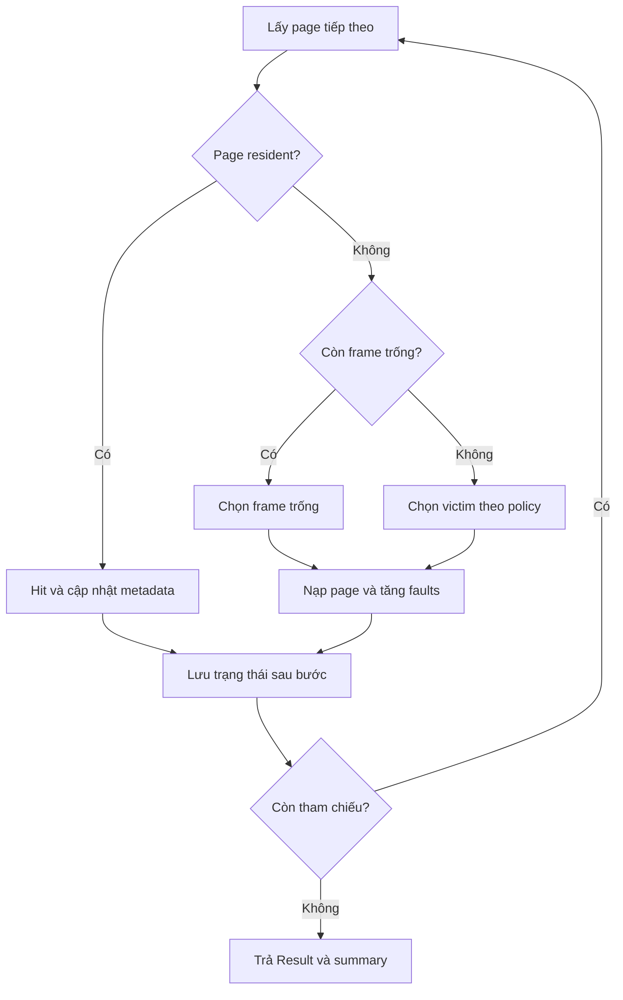
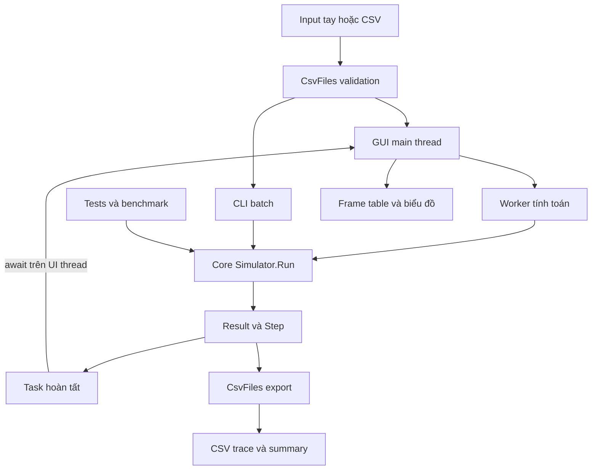

# Sơ đồ mô hình và module

GitHub có thể hiển thị các khối Mermaid dưới đây khi mở tệp Markdown.

## Luồng xử lý một tham chiếu

Tất cả chính sách dùng cùng quy tắc hit/fault và cold start. Các lựa chọn victim cùng metadata riêng được mô tả tại ALGORITHMS.md.

## Quan hệ module và luồng dữ liệu

Worker không gọi WinForms. GUI cập nhật bằng await và Windows Forms Timer trên main thread. Lõi không import GUI hay API tệp; cùng một input có kết quả quyết định giống nhau qua CLI và GUI.
